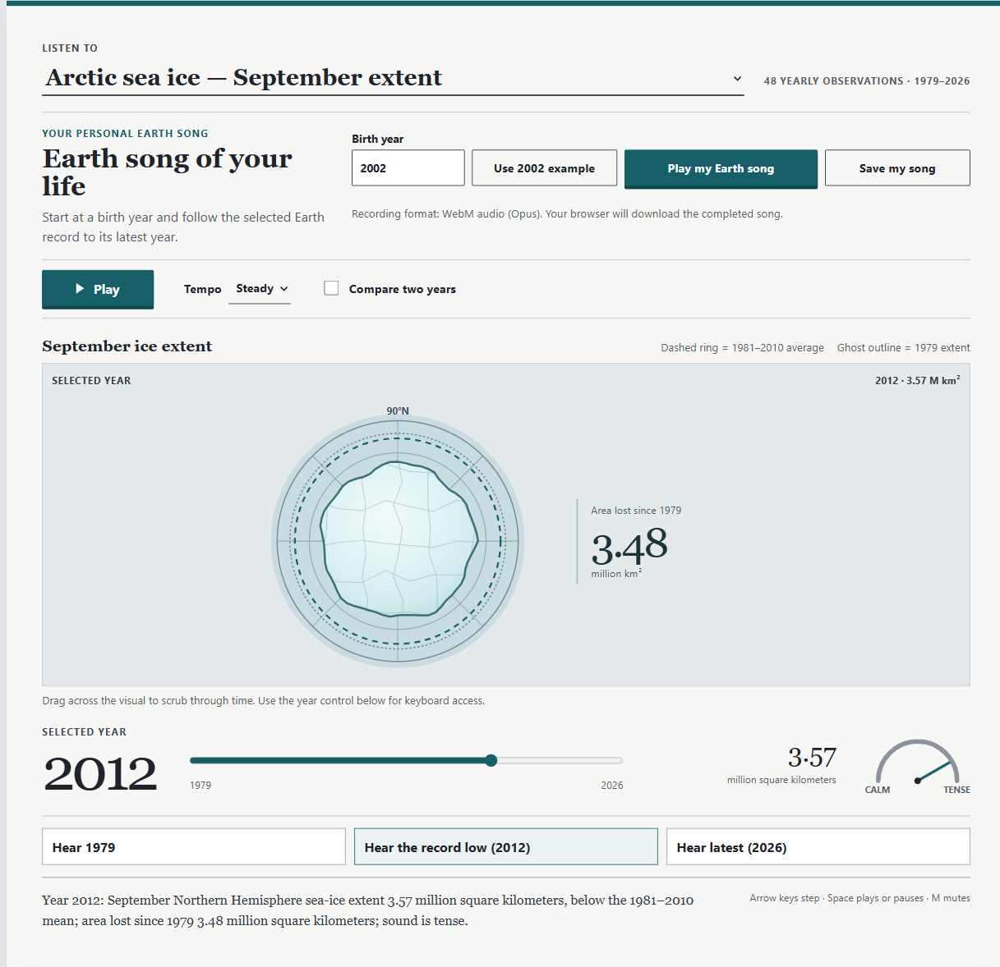
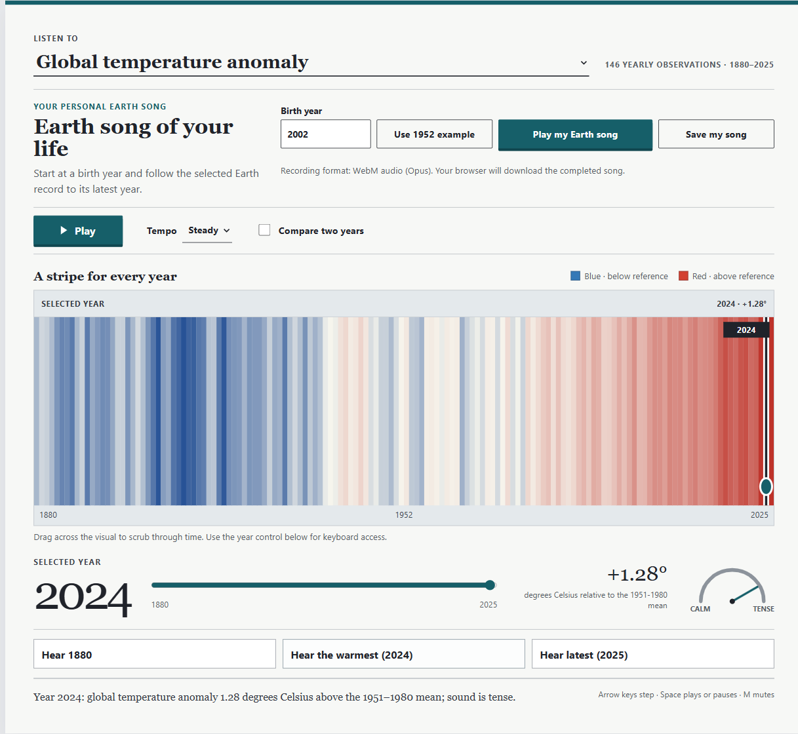
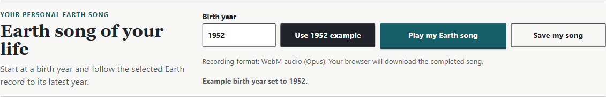

# Earth Listens

Earth Listens is a playable instrument for exploring real NASA GISS temperature and NSIDC Arctic sea-ice records, one year at a time.

**[Open the live instrument](https://srishtipandey1.github.io/earth-listens/)**

## Hear it in 30 seconds

1. Open the live site. It starts in silence.
2. Choose **Arctic sea ice — September extent**, then press **Hear the record low (2012)** to hear that observation.
3. Enter a birth year and press **Play my Earth song** to follow the selected record through its latest year.

Sound starts only after a click or key press.

## Screenshots

These are real screenshots captured from the site at a 1440px viewport.

### Arctic sea ice



### Global temperature



### Earth song of your life



## Why it matters

Climate records are often presented as tables and charts. Earth Listens adds a year-by-year sound so people can explore the direction and pace of change by listening, while keeping the observed value and source visible.

The instrument also provides keyboard controls, spoken status updates, and labels for people who use screen readers. These features are intended to support blind and low-vision learners, but have not yet been tested with assistive-technology users.

## Features

- Two data-backed scenes: NASA GISS annual global temperature anomalies and NSIDC Northern Hemisphere September sea-ice extent.
- Year slider and drag-to-scrub visual, with data-derived moment buttons for the first, extreme, and latest observations.
- Compare two years in a left-ear/right-ear stereo presentation.
- **Earth song of your life** plays from a valid birth year through the selected scene's latest year; **Save my song** downloads a completed browser recording.
- Keyboard operation, screen-reader labels and live announcements, visible focus, reduced-motion support, and no sound before a user gesture.
- Temperature stripes and a proportional Arctic ice visual that follow the selected year and playback.

## How the data becomes sound

| Sound part | Data signal | Mapping |
|---|---|---|
| Pitch | Normalized value within the selected dataset's range | Moves through three octaves of a C-D-E-G-A pentatonic scale. |
| Tension | Distance from the scene's reference | Temperature uses the 0 °C anomaly baseline; Arctic tension rises as extent falls below its 1981–2010 mean. |
| Rhythm | Absolute year-to-year change relative to the largest change in that dataset | Sets 1–8 note pulses per year. |
| Texture | The same relative year-to-year change | Scales a soft noise layer from silence to a gain of 0.18. |

The reference years sound calmer: temperature is measured against its published zero-anomaly baseline, and Arctic extent at or above its 1981–2010 mean has no added tension. Larger departures and faster changes add tension, pulses, and texture; the mapping is an educational interpretation, not a scientific measurement of emotion.

See [docs/SONIFICATION.md](docs/SONIFICATION.md) for the full mapping and tests.

## Data

### NASA GISS global temperature anomaly

- **Measures:** Annual global-mean temperature anomaly relative to NASA GISS's 1951–1980 mean.
- **Years:** 1880–2025 (146 annual observations).
- **Units:** Degrees Celsius relative to the 1951–1980 mean.
- **Official source:** [NASA GISTEMP v4 data page](https://data.giss.nasa.gov/gistemp/data_v4.html); [source CSV](https://data.giss.nasa.gov/gistemp/tabledata_v4/GLB.Ts+dSST.csv).
- **Accessed:** 2026-11-14.
- **Citation:** GISTEMP Team. *GISS Surface Temperature Analysis (GISTEMP), version 4.* NASA Goddard Institute for Space Studies. Accessed 2026-11-14.
- **Processing:** The annual `J-D` column is used; unavailable annual rows are skipped and finite values are kept in year order. The bundled values are not AI-generated.
- **Use terms:** The GISTEMP page asks users to cite and credit NASA GISS/GISTEMP; it states no dataset-specific restriction. See [NASA ESDIS data-use guidance](https://www.earthdata.nasa.gov/engage/open-data-services-software-policies/data-use-guidance).

### NSIDC Arctic September sea-ice extent

- **Measures:** September sea-ice extent in the Northern Hemisphere.
- **Years:** 1979–2026 (48 consecutive annual observations).
- **Units:** Million square kilometers.
- **Official source:** [NSIDC Sea Ice Index, Version 4 (G02135)](https://nsidc.org/data/g02135/versions/4); the supplied CSV's [Northern Hemisphere monthly data directory](https://noaadata.apps.nsidc.org/NOAA/G02135/north/monthly/data/).
- **Accessed:** 2026-11-14.
- **Citation:** Fetterer, F., Knowles, K., Meier, W. N., Savoie, M., Windnagel, A. K. & Stafford, T. (2025). *Sea Ice Index* (G02135, Version 4). Boulder, Colorado USA. National Snow and Ice Data Center. [https://doi.org/10.7265/a98x-0f50](https://doi.org/10.7265/a98x-0f50). Accessed 2026-11-14.
- **Processing:** The supplied CSV is filtered to September (`mo=9`) and Northern Hemisphere (`region=N`); its `extent` values are preserved without interpolation or rounding. The processor validates all 48 consecutive years.
- **Use terms:** NSIDC requires citation; see its [data-use and citation policy](https://nsidc.org/about/data-use-and-copyright).

The NSIDC Version 4 user guide says `source_dataset` identifies the input product: NSIDC-0051 through 2024, then NSIDC-0803 (AMSR2) from 2025. It attributes the change to expected loss of SSMIS access and observed SSMIS degradation; pre-2025 Version 4 values are copies of Version 3. This is a documented change in input product, not an interpolation of the annual extent values. See the [official Version 4 user guide](https://nsidc.org/sites/default/files/documents/user-guide/g02135-v004-userguide.pdf).

## Accessibility

The app has labeled native controls, keyboard-operable playback and year selection, visible focus styling, and a polite live region that announces the selected year, value, and a plain-language description. During an Earth song, progress is announced at the start, every five years, and at the end. The `prefers-reduced-motion` setting reduces animation, and audio is not created or played until a user gesture.

No testing with blind or low-vision participants or real assistive-technology users has been completed.

## Challenge fit

NASA Space Apps Challenge's **The Earth Information Jukebox** asks teams to turn Earth information into sound. Earth Listens makes two annual Earth records playable: people can move through time, hear changes, and compare years while the underlying values and citations remain available.

## Run locally

Use Node.js 22.12 or newer. `package.json` defines the project scripts but does not declare an `engines` range; this Node version meets Vite 8's supported requirement and matches the GitHub Pages workflow.

```sh
npm ci
npm run dev
npm test
npm run build
npm run lint
```

The static production site is built into `dist/`; run `npm run preview` to check that build locally. For GitHub Pages, the Vite base path is `/earth-listens/`.

## Project structure

```text
.
├── .github/workflows/deploy.yml
├── docs/
│   ├── images/                 # README screenshots
│   ├── AI_USE.md
│   ├── CONTEXT.md
│   ├── DEMO.md
│   ├── KNOWN_ISSUES.md
│   ├── PROGRESS.md
│   ├── SONIFICATION.md
│   └── TASKS.md
├── public/data/                # Bundled dataset JSON and metadata
├── scripts/                    # Dataset download and processing
├── src/                        # App, visuals, audio, mapping, and tests
├── index.html
├── package.json
└── vite.config.ts
```

## Limitations and honesty

- There is no vegetation scene. The MODIS data links require Earthdata authentication here, and a verified regional processing file is not available; no substitute data is used.
- The Arctic CSV was supplied by a human. The source URL is recorded, but the processor cannot independently confirm where the local file was downloaded from.
- Recording was verified only in Chromium; browser formats and `MediaRecorder` support can differ. Sound quality remains a human judgment, and no human listening review has been completed.
- No real assistive-technology user testing, independent dataset validation, or final event-rule review has been completed.
- `npm audit` reports seven moderate advisories in development dependencies; the runtime-only audit reported none. See [docs/KNOWN_ISSUES.md](docs/KNOWN_ISSUES.md) for details.
- A project software license has not been selected. NASA/NSIDC data terms do not supply a license for this code.

## How we used AI

The project used an AI assistant with Copilot SDK in VS Code to scaffold and implement the app, data-processing scripts, tests, and documentation, and to run automated and Chromium browser checks. A human supplied the project concept and acceptance criteria, selected and downloaded the Arctic CSV, and provided its source URL. Human listening, independent review, data-term confirmation, and checking the event's AI-use and submission rules remain outstanding. No synthetic or AI-generated observations were used. See [docs/AI_USE.md](docs/AI_USE.md).

## Team

- **Team:** `<TEAM NAME>`
- **Member:** Srishti Pandey
- **License:** `[Add license here]`
